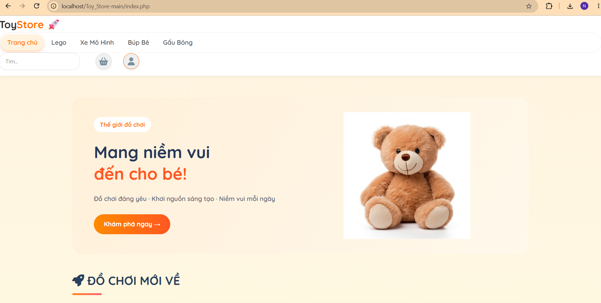
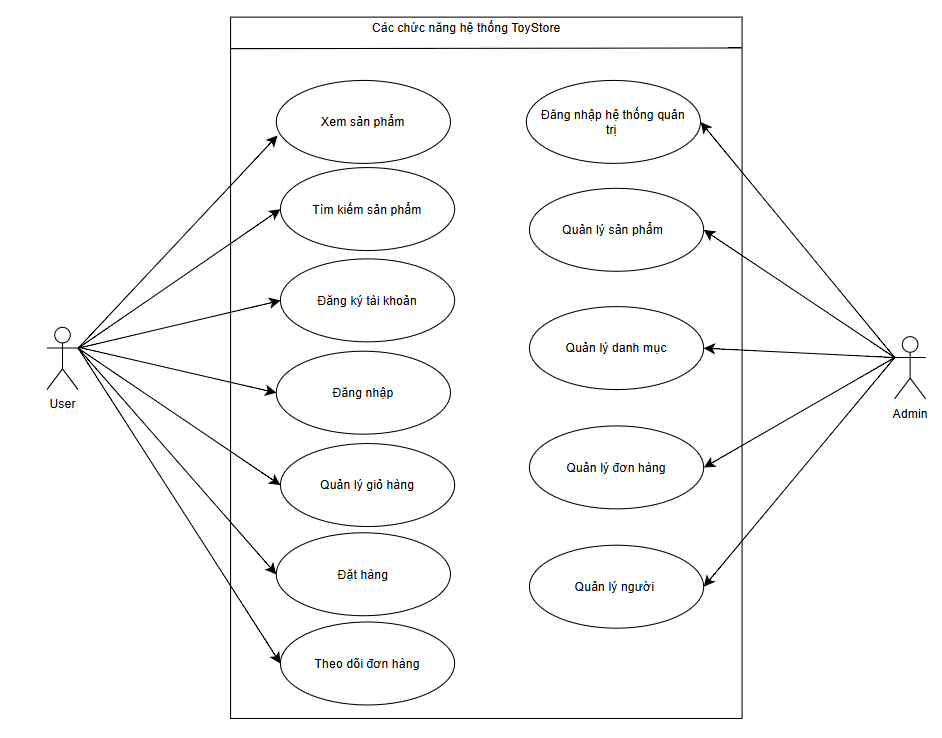

## 🧸 KIỂM THỬ VÀ ĐÁNH GIÁ CHẤT LƯỢNG WEBSITE TOYSTORE – NỀN TẢNG THƯƠNG MẠI ĐIỆN TỬ DÀNH CHO TRẺ EM

Dự án bài tập lớn học phần Đánh giá và Kiểm định chất lượng phần mềm, Trường Công nghệ thông tin, Đại học Phenikaa.
Đề tài tập trung phân tích yêu cầu, xây dựng kế hoạch kiểm thử, thiết kế test case, thực thi và đánh giá chất lượng website ToyStore – nền tảng thương mại điện tử chuyên cung cấp các sản phẩm đồ chơi dành cho trẻ em.

## 📖 Mục Lục

1. [Tổng Quan Dự Án](#-tổng-quan-dự-án)
2. [Cấu Trúc Thư Mục](#-cấu-trúc-thư-mục-project-structure)
3. [Kiến Trúc Hệ Thống](#-kiến-trúc-hệ-thống)
4. [Chức Năng Chi Tiết](#-chức-năng-chi-tiết)
5. [Yêu Cầu Cài Đặt](#-yêu-cầu-cài-đặt)
6. [Hướng Dẫn Triển Khai](#-hướng-dẫn-triển-khai)
7. [Đội Ngũ Phát Triển](#-đội-ngũ-phát-triển)

---
## 1. Thông tin đề tài
| **Nội dung** | **Thông tin** |
|---|---|
| Tên đề tài | Kiểm thử và đánh giá chất lượng website ToyStore – nền tảng thương mại điện tử dành cho trẻ em |
| Học phần | Đánh giá và kiểm định chất lượng phần mềm |
| Giảng viên hướng dẫn | TS. Trịnh Thanh Bình |
| Đơn vị | Trường Công nghệ thông tin, Đại học Phenikaa |
| Thời gian báo cáo | Tháng 10/2026 |
## Thành viên thực hiện 
| **STT** | **Họ và tên** | **Mã sinh viên** | 
|---|---|---|
| 1 | Vũ Mai Quỳnh | 23010223 |
| 2 | Trần Thị Ngoãn | 23010154 |

## 2. MỤC TIÊU
- Phân tích các yêu cầu chức năng và phi chức năng của website ToyStore.
- Xây dựng kế hoạch, kịch bản và các trường hợp kiểm thử cho các chức năng chính của hệ thống.
- Thực hiện kiểm thử Unit Test để đánh giá tính chính xác của các hàm xử lý trong chương trình.
- Sử dụng Postman để kiểm tra các yêu cầu HTTP và khả năng phản hồi của website.
- Sử dụng JMeter để đánh giá hiệu năng và khả năng chịu tải khi có nhiều người dùng truy cập đồng thời.
- Phát hiện lỗi trong quá trình xử lý dữ liệu, quản lý sản phẩm, giỏ hàng và đặt hàng; tổng hợp kết quả, đánh giá chất lượng và đề xuất hướng khắc phục.
## 3. CHỨC NĂNG

## 3.1. Chức năng dành cho khách hàng
Website ToyStore cung cấp các chức năng chính dành cho khách hàng như sau:

| STT | Chức năng | Mô tả |
|---:|---|---|
| 1 | Xem trang chủ | Hiển thị banner, sản phẩm và danh mục đồ chơi |
| 2 | Xem danh mục | Hiển thị sản phẩm theo từng danh mục |
| 3 | Tìm kiếm sản phẩm | Tìm sản phẩm theo từ khóa |
| 4 | Xem chi tiết sản phẩm | Hiển thị hình ảnh, giá và thông tin sản phẩm |
| 5 | Đăng ký tài khoản | Tạo tài khoản khách hàng |
| 6 | Đăng nhập | Xác thực thông tin tài khoản |
| 7 | Giỏ hàng | Thêm, cập nhật và xóa sản phẩm |
| 8 | Đặt hàng | Nhập thông tin nhận hàng và xác nhận đơn |
| 9 | Thanh toán | Lựa chọn phương thức thanh toán |
| 10 | Theo dõi đơn hàng | Xem thông tin đơn hàng đã đặt |

## 3.2. Chức năng dành cho quản trị viên

| STT | Chức năng | Mô tả |
|---:|---|---|
| 1 | Đăng nhập quản trị | Xác thực tài khoản quản trị viên |
| 2 | Quản lý sản phẩm | Thêm, sửa, xóa và xem sản phẩm |
| 3 | Quản lý danh mục | Quản lý các nhóm sản phẩm |
| 4 | Quản lý đơn hàng | Xem và cập nhật trạng thái đơn hàng |
| 5 | Quản lý người dùng | Theo dõi thông tin khách hàng |
| 6 | Quản lý dữ liệu | Kiểm tra và quản lý thông tin trong hệ thống |

## 📂 Cấu Trúc Thư Mục (Project Structure)

Cấu trúc mã nguồn được tổ chức theo mô hình module hóa, tách biệt rõ ràng giữa quản trị (Admin), giao diện (Assets) và logic xử lý (Modules):

---

ToyStore/
├── admin/                       # Các trang quản trị dành cho chủ cửa hàng
│   ├── index.php                # Bảng điều khiển (Dashboard) admin
│   ├── order_detail.php         # Xem và xử lý chi tiết đơn hàng
│   ├── product_add.php          # Thêm sản phẩm đồ chơi mới
│   ├── product_delete.php       # Xóa sản phẩm khỏi hệ thống
│   ├── product_edit.php         # Chỉnh sửa thông tin sản phẩm
│   └── sidebar.php              # Thanh điều hướng bên của trang admin
├── assets/                      # TÀI NGUYÊN TĨNH
│   ├── css/                     # Các file định dạng giao diện 
│   └── images/                  # Kho ảnh sản phẩm và banner
├── config/                      # Cấu hình hệ thống
│   └── db.php                   # Thiết lập kết nối cơ sở dữ liệu MySQL
├── includes/                    # Các thành phần giao diện dùng chung (Components)
│   ├── footer.php               # Chân trang web
│   └── header.php               # Thanh menu và đầu trang web
├── models/                      # Chứa các lớp xử lý và truy vấn dữ liệu tập trung
│   ├── OrderModel.php           # Xử lý các nghiệp vụ liên quan đến đơn hàng
│   ├── ProductModel.php         # Xử lý các nghiệp vụ liên quan đến sản phẩm
│   └── UserModel.php            # Xử lý các nghiệp vụ liên quan đến tài khoản người dùng
├── modules/                     # Chứa nội dung và logic của các trang chức năng người dùng
│   ├── cart.php                 # Giao diện và xử lý giỏ hàng
│   ├── category.php             # Hiển thị sản phẩm theo danh mục
│   ├── checkout.php             # Trang thanh toán và hoàn tất đặt hàng
│   ├── detail.php               # Xem thông tin chi tiết một món đồ chơi
│   ├── home.php                 # Giao diện trang chủ hiển thị sản phẩm mới
│   ├── orders.php               # Xem lịch sử các đơn hàng đã đặt
│   ├── profile.php              # Quản lý thông tin cá nhân khách hàng
│   └── search.php               # Kết quả tìm kiếm sản phẩm
├── index.php                    # Tệp điều hướng chính của hệ thống
├── login.php                    # Trang đăng nhập thành viên
├── logout.php                   # Xử lý đăng xuất khỏi hệ thống
├── register.php                 # Trang đăng ký tài khoản mới
└── README.md                    # Tài liệu hướng dẫn dự án
---

## 🏗 Kiến Trúc Hệ Thống

Hệ thống hoạt động dựa trên cơ chế Routing cơ bản tại index.php. Mọi yêu cầu từ người dùng sẽ đi qua Router để gọi các module tương ứng từ thư mục modules/.

Sơ đồ luồng dữ liệu (Simplified Data Flow):
Request: Người dùng truy cập index.php?page=cart

Routing: File index.php kiểm tra tham số page.

Controller: Gọi file modules/cart.php.

View: Hiển thị giao diện Giỏ hàng kèm dữ liệu từ Session/Database.

---

## ✨ Chức Năng Chi Tiết

1. Phân hệ Khách hàng (Front-end)
   Authentication: Đăng ký, Đăng nhập, Đăng xuất (login.php, register.php).

Mua sắm: Xem sản phẩm, Lọc theo danh mục, Tìm kiếm thông minh.

Đặt hàng: Quy trình thêm vào giỏ hàng và thanh toán nhanh gọn.

Cá nhân: Quản lý thông tin tài khoản (profile.php).

2. Phân hệ Quản trị (Back-end)
   Quản lý Sản phẩm (CRUD): Thêm, Sửa, Xóa, Cập nhật hình ảnh.

Quản lý Đơn hàng: Theo dõi trạng thái đơn hàng, xem chi tiết người mua.

Thống kê: Báo cáo doanh thu và tình trạng kho hàng thực tế.

---

## ⚙️ Yêu Cầu Cài Đặt

Web Server: XAMPP / WAMP (Apache).

PHP Version: 7.4 trở lên.

Database: MySQL.

Trình duyệt: Chrome/Edge bản mới nhất.
