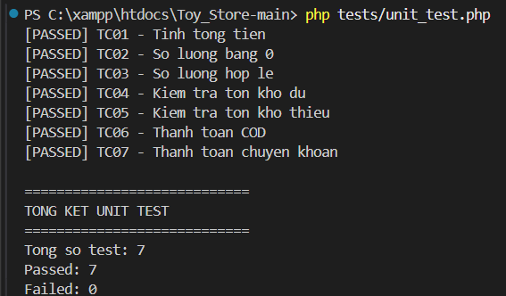

## 🧸 KIỂM THỬ VÀ ĐÁNH GIÁ CHẤT LƯỢNG WEBSITE TOYSTORE – NỀN TẢNG THƯƠNG MẠI ĐIỆN TỬ DÀNH CHO TRẺ EM

Dự án bài tập lớn học phần Đánh giá và Kiểm định chất lượng phần mềm, Trường Công nghệ thông tin, Đại học Phenikaa.
Đề tài tập trung phân tích yêu cầu, xây dựng kế hoạch kiểm thử, thiết kế test case, thực thi và đánh giá chất lượng website ToyStore – nền tảng thương mại điện tử chuyên cung cấp các sản phẩm đồ chơi dành cho trẻ em.

## 📖 Mục Lục

1. [Tổng Quan Dự Án](#-tổng-quan-dự-án)
2. [Cấu Trúc Thư Mục](#-cấu-trúc-thư-mục-project-structure)
3. [Kiến Trúc Hệ Thống](#-kiến-trúc-hệ-thống)
4. [Chức Năng Chi Tiết](#-chức-năng-chi-tiết)
5. [Yêu Cầu Cài Đặt](#-yêu-cầu-cài-đặt)
6. [Hướng Dẫn Triển Khai](#-hướng-dẫn-triển-khai)
7. [Đội Ngũ Phát Triển](#-đội-ngũ-phát-triển)

---
## 1. Thông tin đề tài
| **Nội dung** | **Thông tin** |
|---|---|
| Tên đề tài | Kiểm thử và đánh giá chất lượng website ToyStore – nền tảng thương mại điện tử dành cho trẻ em |
| Học phần | Đánh giá và kiểm định chất lượng phần mềm |
| Giảng viên hướng dẫn | TS. Trịnh Thanh Bình |
| Đơn vị | Trường Công nghệ thông tin, Đại học Phenikaa |
| Thời gian báo cáo | Tháng 10/2026 |
## Thành viên thực hiện 
| **STT** | **Họ và tên** | **Mã sinh viên** | 
|---|---|---|
| 1 | Vũ Mai Quỳnh | 23010223 |
| 2 | Trần Thị Ngoãn | 23010154 |

## 2. MỤC TIÊU
- Phân tích các yêu cầu chức năng và phi chức năng của website ToyStore.
- Xây dựng kế hoạch, kịch bản và các trường hợp kiểm thử cho các chức năng chính của hệ thống.
- Thực hiện kiểm thử Unit Test để đánh giá tính chính xác của các hàm xử lý trong chương trình.
- Sử dụng Postman để kiểm tra các yêu cầu HTTP và khả năng phản hồi của website.
- Sử dụng JMeter để đánh giá hiệu năng và khả năng chịu tải khi có nhiều người dùng truy cập đồng thời.
- Phát hiện lỗi trong quá trình xử lý dữ liệu, quản lý sản phẩm, giỏ hàng và đặt hàng; tổng hợp kết quả, đánh giá chất lượng và đề xuất hướng khắc phục.
## 3. CHỨC NĂNG
Website có hai nhóm tác nhân: Khách hàng và quản trị viên
** Biểu đồ usecase tổng quát**

Biểu đồ trích từ báo cáo, mô tả phạm vi yêu cầu. Một số chức năng trong thiết kế chưa được triển khai đầy đủ.
## 3.1. Chức năng dành cho khách hàng
Website ToyStore cung cấp các chức năng chính dành cho khách hàng như sau:

| STT | Chức năng | Mô tả |
|---:|---|---|
| 1 | Xem trang chủ | Hiển thị banner, sản phẩm và danh mục đồ chơi |
| 2 | Xem danh mục | Hiển thị sản phẩm theo từng danh mục |
| 3 | Tìm kiếm sản phẩm | Tìm sản phẩm theo từ khóa |
| 4 | Xem chi tiết sản phẩm | Hiển thị hình ảnh, giá và thông tin sản phẩm |
| 5 | Đăng ký tài khoản | Tạo tài khoản khách hàng |
| 6 | Đăng nhập | Xác thực thông tin tài khoản |
| 7 | Giỏ hàng | Thêm, cập nhật và xóa sản phẩm |
| 8 | Đặt hàng | Nhập thông tin nhận hàng và xác nhận đơn |
| 9 | Thanh toán | Lựa chọn phương thức thanh toán |
| 10 | Theo dõi đơn hàng | Xem thông tin đơn hàng đã đặt |

## 3.2. Chức năng dành cho quản trị viên

| STT | Chức năng | Mô tả |
|---:|---|---|
| 1 | Đăng nhập quản trị | Xác thực tài khoản quản trị viên |
| 2 | Quản lý sản phẩm | Thêm, sửa, xóa và xem sản phẩm |
| 3 | Quản lý danh mục | Quản lý các nhóm sản phẩm |
| 4 | Quản lý đơn hàng | Xem và cập nhật trạng thái đơn hàng |
| 5 | Quản lý người dùng | Theo dõi thông tin khách hàng |
| 6 | Quản lý dữ liệu | Kiểm tra và quản lý thông tin trong hệ thống |
## 4. Công nghệ sử dụng

| **Thành phần** | **Công nghệ** |
|---|---|
| Ngôn ngữ lập trình | PHP |
| Cơ sở dữ liệu | MySQL |
| Giao diện | HTML, CSS, JavaScript |
| Môi trường phát triển | XAMPP |
| Trình soạn thảo mã nguồn | Visual Studio Code |
| Quản lý phiên bản | Git |
| Lưu trữ mã nguồn | GitHub |
| Kiểm thử đơn vị | Unit Test (PHP) |
| Kiểm thử HTTP | Postman |
| Kiểm thử hiệu năng | Apache JMeter |
## 📂 Cấu Trúc Thư Mục (Project Structure)

Cấu trúc mã nguồn được tổ chức theo mô hình module hóa, tách biệt rõ ràng giữa quản trị (Admin), giao diện (Assets) và logic xử lý (Modules):

```text

ToyStore/
├── admin/
│   ├── index.php
│   ├── order_detail.php
│   ├── product_add.php
│   ├── product_delete.php
│   ├── product_edit.php
│   └── sidebar.php
├── assets/
│   ├── css/
│   └── images/
├── config/
│   └── db.php
├── includes/
│   ├── footer.php
│   └── header.php
├── models/
│   ├── OrderModel.php
│   ├── ProductModel.php
│   └── UserModel.php
├── modules/
│   ├── cart.php
│   ├── category.php
│   ├── checkout.php
│   ├── detail.php
│   ├── home.php
│   ├── orders.php
│   ├── profile.php
│   └── search.php
├── tests/
│   └── uni_test.php
├── index.php
├── login.php
├── logout.php
├── register.php
└── README.md
```
## Vai trò các thành phần 

| STT | Đường dẫn | Vai trò |
|---:|---|---|
| 1 | `admin/` | Chứa các trang quản trị dành cho quản trị viên. |
| 2 | `admin/index.php` | Hiển thị bảng điều khiển quản trị. |
| 3 | `admin/order_detail.php` | Xem và xử lý chi tiết đơn hàng. |
| 4 | `admin/product_add.php` | Thêm sản phẩm mới. |
| 5 | `admin/product_delete.php` | Xóa sản phẩm khỏi hệ thống. |
| 6 | `admin/product_edit.php` | Chỉnh sửa thông tin sản phẩm. |
| 7 | `admin/sidebar.php` | Hiển thị thanh điều hướng trang quản trị. |
| 8 | `assets/` | Chứa tài nguyên tĩnh của website. |
| 9 | `assets/css/` | Chứa các tệp định dạng giao diện CSS. |
| 10 | `assets/images/` | Lưu trữ hình ảnh sản phẩm và banner. |
| 11 | `config/` | Chứa các tệp cấu hình hệ thống. |
| 12 | `config/db.php` | Thiết lập kết nối cơ sở dữ liệu MySQL. |
| 13 | `includes/` | Chứa các thành phần giao diện dùng chung. |
| 14 | `includes/header.php` | Hiển thị phần đầu trang và thanh menu. |
| 15 | `includes/footer.php` | Hiển thị phần chân trang. |
| 16 | `models/` | Chứa các lớp xử lý nghiệp vụ và truy vấn dữ liệu. |
| 17 | `models/OrderModel.php` | Xử lý dữ liệu và nghiệp vụ đơn hàng. |
| 18 | `models/ProductModel.php` | Xử lý dữ liệu và nghiệp vụ sản phẩm. |
| 19 | `models/UserModel.php` | Xử lý dữ liệu tài khoản người dùng. |
| 20 | `modules/` | Chứa các trang chức năng dành cho khách hàng. |
| 21 | `modules/cart.php` | Hiển thị và xử lý giỏ hàng. |
| 22 | `modules/category.php` | Hiển thị sản phẩm theo danh mục. |
| 23 | `modules/checkout.php` | Xử lý thanh toán và đặt hàng. |
| 24 | `modules/detail.php` | Hiển thị thông tin chi tiết sản phẩm. |
| 25 | `modules/home.php` | Hiển thị trang chủ và danh sách sản phẩm. |
| 26 | `modules/orders.php` | Hiển thị lịch sử đơn hàng. |
| 27 | `modules/profile.php` | Quản lý thông tin cá nhân khách hàng. |
| 28 | `modules/search.php` | Xử lý và hiển thị kết quả tìm kiếm. |
| 29 | `tests/` | Chứa các tệp phục vụ kiểm thử Unit Test. |
| 30 | `tests/uni_test.php` | Chứa các trường hợp kiểm thử các hàm xử lý. |
| 31 | `index.php` | Tệp điều hướng chính của website. |
| 32 | `login.php` | Xử lý chức năng đăng nhập. |
| 33 | `logout.php` | Xử lý chức năng đăng xuất. |
| 34 | `register.php` | Xử lý chức năng đăng ký tài khoản. |
| 35 | `README.md` | Cung cấp thông tin và hướng dẫn cài đặt, sử dụng dự án. |
## 6. CÀI ĐẶT VÀ CHẠY DỰ ÁN

## 6.1. Yêu cầu

Để cài đặt và chạy website ToyStore trên máy tính, cần chuẩn bị các công cụ sau:
- PHP 8.x
- Git
- XAMPP
- Visual Studio Code
- phpMyAdmin
- Kết nối mạng khi tải mã nguồn và cài đặt các công cụ cần thiết.

## 6.2. Tải mã nguồn
Tải mã nguồn dự án từ GitHub tại repository: ToyStore – GitHub.

Chọn Code → Download ZIP để tải và giải nén mã nguồn, sau đó đổi tên thư mục thành Toy_Store-main (nếu cần) và sao chép vào đường dẫn:
```text
C:\xampp\htdocs\Toy_Store-main
```

Hoặc sử dụng Git để tải mã nguồn trực tiếp:
```text
cd C:\xampp\htdocs
git clone https://github.com/ngoantran05/Danh-Gia-Chat-Luong-Phan-Mem_nhom-5.git
```
## 6.3. Cài thư viện PHP
```text
composer install
```
6.4. Tạo cấu hình môi trường
Mở tệp config/db.php và kiểm tra, cập nhật thông tin kết nối cơ sở dữ liệu phù hợp với môi trường XAMPP:
```text
$host = "localhost";
$username = "root";
$password = "";
$database = "toystore_db";
```
Các thông tin trên áp dụng cho cấu hình MySQL mặc định của XAMPP. Nếu máy tính sử dụng mật khẩu hoặc cổng MySQL khác, cần điều chỉnh cho phù hợp.

## 6.5. Tạo cơ sở dữ liệu
Khởi động Apache và MySQL trong XAMPP Control Panel, sau đó truy cập phpMyAdmin.

Tạo cơ sở dữ liệu có tên toystore_db với mã SQL:
```text
CREATE DATABASE toystore_db
CHARACTER SET utf8
COLLATE utf8_general_ci;
```
Chọn cơ sở dữ liệu toystore_db và nhập tệp SQL được cung cấp trong mã nguồn (nếu có) để tạo các bảng dữ liệu.
## 6.6. Khởi động website
Khởi động Apache và MySQL trong XAMPP, sau đó mở trình duyệt và truy cập địa chỉ:

Truy cập (http://localhost/Toy_Store-main/) 

Kiểm tra giao diện trang chủ, danh sách sản phẩm và các chức năng chính để xác nhận website hoạt động bình thường.
Sau khi khởi động website, kiểm tra khả năng truy cập, kết nối cơ sở dữ liệu, hiển thị sản phẩm và hoạt động của các chức năng đăng nhập, giỏ hàng, đặt hàng.

Nếu xuất hiện lỗi, cần kiểm tra lại thông tin kết nối trong config/db.php, bao gồm host, tên database, username, password và cổng MySQL.
## 6.8. Tài khoản mẫu
| **Vai trò** | **Email** | **Mật khẩu** | **Trang sau đăng nhập** |
|---|---|---|---|
| Quản trị viên | admin123@gmail.com | admin | /admin |
| Khách hàng | user12345@gmail.com | user | /home |
**Lưu ý:** Đây là các tài khoản do Seeder tạo để phục vụ thử nghiệm trên môi trường local. Mật khẩu ngắn là dữ liệu mẫu có sẵn; đối với tài khoản đăng ký mới, hệ thống yêu cầu mật khẩu tối thiểu 8 ký tự.
## 7. KIỂM THỬ PHẦN MỀM

## 7.1. Kiểm thử Unit Test

### 7.1. Kiểm thử Unit Test

Unit Test là phương pháp kiểm thử từng đơn vị nhỏ của chương trình, thường là các hàm hoặc phương thức, nhằm xác định kết quả xử lý có đáp ứng yêu cầu hay không.

Trong dự án ToyStore, Unit Test được sử dụng để kiểm tra các chức năng tính tổng tiền, xử lý số lượng sản phẩm, kiểm tra tồn kho và phương thức thanh toán.

**Công cụ sử dụng:** PHP, PowerShell.

**Tệp kiểm thử:** `tests/unit_test.php`.

**Các trường hợp kiểm thử:**

| **Mã TC** | **Nội dung kiểm thử** | **Kết quả mong đợi** |
|---|---|---|
| UT01 | Kiểm tra tính tổng tiền | Tổng tiền được tính chính xác |
| UT02 | Kiểm tra số lượng bằng 0 | Không chấp nhận số lượng không hợp lệ |
| UT03 | Kiểm tra số lượng hợp lệ | Chấp nhận số lượng hợp lệ |
| UT04 | Kiểm tra tồn kho đủ | Cho phép xử lý khi tồn kho đáp ứng |
| UT05 | Kiểm tra tồn kho thiếu | Không cho phép mua vượt số lượng tồn |
| UT06 | Kiểm tra phương thức thanh toán COD | Nhận diện đúng phương thức COD |
| UT07 | Kiểm tra phương thức chuyển khoản | Nhận diện đúng phương thức chuyển khoản |

**Cách thực hiện:**

Mở PowerShell tại thư mục dự án và chạy lệnh:

```bash
php tests/unit_test.php
```

**Kết quả kiểm thử:**

| **Chỉ tiêu** | **Kết quả** |
|---|---:|
| Tổng số test | 7 |
| Passed | 7 |
| Failed | 0 |
| Tỷ lệ thành công | 100% |

Kết quả cho thấy cả 7 trường hợp kiểm thử đều đạt yêu cầu, không có trường hợp thất bại.

**Hình ảnh minh chứng:**



## 7.2. Kiểm thử bằng Postman

7.2.1. Mục tiêu

Postman là công cụ hỗ trợ gửi các yêu cầu HTTP đến máy chủ và kiểm tra phản hồi trả về.

Trong đề tài, Postman được sử dụng để kiểm tra khả năng phản hồi của website ToyStore thông qua các phương thức HTTP như GET và POST.

7.2.2. Công cụ sử dụng

Postman.

Website ToyStore chạy trên localhost.

Giao thức HTTP.

7.2.3. Các trường hợp kiểm thử

Mã TC

Phương thức

Địa chỉ kiểm thử

Mục đích

API01

GET

http://localhost/Toy_Store-main/

Kiểm tra khả năng truy cập trang chủ

API02

GET

http://localhost/Toy_Store-main/index.php?mod=cart

Kiểm tra trang giỏ hàng

API03

GET

http://localhost/Toy_Store-main/index.php?mod=checkout

Kiểm tra trang thanh toán

API04

GET

http://localhost/Toy_Store-main/index.php?mod=cart&act=del&id=18

Kiểm tra yêu cầu xóa sản phẩm khỏi giỏ hàng

API05

POST

Theo URL và dữ liệu POST của chức năng được kiểm thử

Kiểm tra khả năng gửi dữ liệu đến máy chủ

7.2.4. Cách thực hiện

Bước 1: Mở Postman.

Bước 2: Tạo một HTTP Request mới.

Bước 3: Chọn phương thức GET hoặc POST.

Bước 4: Nhập địa chỉ website cần kiểm thử.

Bước 5: Với phương thức POST, nhập dữ liệu vào phần Body theo đúng tên trường mà mã nguồn xử lý.

Bước 6: Nhấn Send để gửi yêu cầu.

Bước 7: Quan sát kết quả phản hồi.

Các thông tin cần ghi nhận:

Status Code.

Response Body.

Thời gian phản hồi.

Kích thước dữ liệu trả về.

Nội dung phản hồi có phù hợp với yêu cầu hay không.

7.2.5. Đánh giá kết quả

Đối với các yêu cầu GET, cần kiểm tra máy chủ có trả về nội dung phù hợp hay không.

Đối với các yêu cầu POST, cần kiểm tra dữ liệu gửi lên có được tiếp nhận và xử lý đúng hay không.

Lưu ý: Website PHP sử dụng cơ chế điều hướng qua tham số mod và act, không mặc nhiên là một REST API độc lập. Vì vậy, khi kiểm thử cần lựa chọn đúng URL, phương thức HTTP và dữ liệu đầu vào theo cách mà mã nguồn thực tế xử lý.

HTTP 200 chỉ thể hiện yêu cầu được máy chủ phản hồi thành công ở mức giao thức, không đồng nghĩa với việc nghiệp vụ đã xử lý chính xác.

[CHÈN HÌNH 7.3: Kết quả kiểm thử phương thức GET bằng Postman.]

[CHÈN HÌNH 7.4: Kết quả kiểm thử phương thức POST bằng Postman.]

## 7.3. Kiểm thử hiệu năng bằng JMeter

7.3.1. Mục tiêu

Apache JMeter là công cụ kiểm thử hiệu năng, được sử dụng để đánh giá khả năng phản hồi của hệ thống khi có nhiều yêu cầu được gửi đến trong cùng một khoảng thời gian.

Trong đề tài, JMeter được sử dụng để đánh giá khả năng xử lý các yêu cầu truy cập website ToyStore khi số lượng người dùng đồng thời tăng lên.

7.3.2. Công cụ sử dụng

Apache JMeter 5.6.3.

Website ToyStore chạy trên XAMPP.

HTTP Request.

Thread Group.

Summary Report.

View Results Tree.

7.3.3. Cấu hình kiểm thử

Các thông số cấu hình cần ghi nhận trong bài kiểm thử:

Thông số

Giá trị

Number of Threads (Users)

Theo kịch bản chạy thực tế

Ramp-up Period

Theo cấu hình thực tế

Loop Count

Theo cấu hình thực tế

Protocol

HTTP

Server Name

localhost

Port

Theo cấu hình Apache

Path

Đường dẫn chức năng cần kiểm thử

Method

GET hoặc POST

7.3.4. Các bước thực hiện

Bước 1: Mở Apache JMeter.

Bước 2: Tạo một Test Plan mới.

Bước 3: Thêm Thread Group để cấu hình số lượng người dùng đồng thời.

Bước 4: Thêm HTTP Request để khai báo địa chỉ website và phương thức gửi yêu cầu.

Bước 5: Thêm các Listener cần thiết:

View Results Tree.

Summary Report.

Aggregate Report (nếu cần).

Bước 6: Nhấn Start để bắt đầu kiểm thử.

Bước 7: Quan sát kết quả và lưu lại báo cáo.

7.3.5. Các chỉ số đánh giá

Chỉ số

Ý nghĩa

Samples

Tổng số yêu cầu được gửi

Average

Thời gian phản hồi trung bình

Median

Thời gian phản hồi trung vị

90% Line

90% yêu cầu có thời gian phản hồi không vượt quá giá trị này

Throughput

Số yêu cầu được xử lý trong một đơn vị thời gian

Error %

Tỷ lệ yêu cầu xảy ra lỗi

Min

Thời gian phản hồi nhỏ nhất

Max

Thời gian phản hồi lớn nhất

7.3.6. Đánh giá kết quả

Thông qua các chỉ số trên, có thể đánh giá khả năng xử lý yêu cầu của website.

Average càng thấp thì thời gian phản hồi trung bình càng nhanh.

Throughput càng cao thì khả năng xử lý yêu cầu trong một đơn vị thời gian càng lớn.

Error % càng thấp thì hệ thống càng ổn định trong kịch bản kiểm thử.

Median và 90% Line giúp đánh giá mức độ ổn định của thời gian phản hồi.

[CHÈN HÌNH 7.5: Cấu hình Thread Group trong JMeter.]

[CHÈN HÌNH 7.6: Cấu hình HTTP Request trong JMeter.]

[CHÈN HÌNH 7.7: Kết quả Summary Report hoặc Aggregate Report của JMeter.]

## 8. KẾT QUẢ KIỂM THỬ

### 8.1. Kết quả Unit Test

Sau khi thực hiện Unit Test bằng PHP, kết quả được tổng hợp như sau:

| **Nội dung** | **Kết quả** |
|---|---:|
| Tổng số test case | 7 |
| Số test case PASSED | 7 |
| Số test case FAILED | 0 |
| Tỷ lệ thành công | 100% |

**Công thức tính tỷ lệ thành công:**

Tỷ lệ thành công = (Số test case PASSED / Tổng số test case) × 100%

**Nhận xét:** Cả 7 trường hợp kiểm thử đều đạt yêu cầu, không có trường hợp thất bại. Điều này cho thấy các chức năng được kiểm tra hoạt động đúng theo kết quả mong đợi trong phạm vi Unit Test đã xây dựng.
## 8.2. Kết quả Postman

Kết quả kiểm thử Postman được tổng hợp theo các yêu cầu HTTP đã thực hiện.

Mã TC

Phương thức

Status Code

Thời gian phản hồi

Kết quả

API01

GET

........

........

........

API02

GET

........

........

........

API03

GET

........

........

........

API04

GET

........

........

........

API05

POST

........

........

........

Nhận xét: Postman hỗ trợ kiểm tra khả năng tiếp nhận và phản hồi yêu cầu của website. Ngoài mã trạng thái HTTP, cần đối chiếu nội dung phản hồi với kết quả nghiệp vụ mong đợi.

## 8.3. Kết quả JMeter

Kết quả kiểm thử hiệu năng được ghi nhận dựa trên Summary Report hoặc Aggregate Report.

Chỉ số

Kết quả

Number of Threads

........

Ramp-up Period

........

Loop Count

........

Samples

........

Average

........ ms

Median

........ ms

90% Line

........ ms

Throughput

........

Error %

........ %

Nhận xét: Các chỉ số trên được sử dụng để đánh giá thời gian phản hồi, khả năng xử lý yêu cầu và tỷ lệ lỗi của website trong điều kiện kiểm thử đã thiết lập.

## 8.4. Xem báo cáo 

Các kết quả kiểm thử được lưu lại để phục vụ việc theo dõi, đánh giá và đối chiếu:

- [Mã nguồn dự án ToyStore](https://github.com/ngoantran05/Danh-Gia-Chat-Luong-Phan-Mem_nhom-5)
- [Thư mục kiểm thử Unit Test](https://github.com/ngoantran05/Danh-Gia-Chat-Luong-Phan-Mem_nhom-5/tree/main/tests) 
## 9. CÁC VẤN ĐỀ ĐÃ BIẾT

Trong quá trình phát triển và kiểm thử website ToyStore, một số vấn đề cần lưu ý gồm:

| **STT** | **Vấn đề** | **Ảnh hưởng** | **Hướng xử lý** |
|---|---|---|---|
| 1 | Dữ liệu đầu vào không hợp lệ | Có thể gây lỗi khi xử lý | Kiểm tra và xác thực dữ liệu |
| 2 | Số lượng sản phẩm vượt tồn kho | Có thể dẫn đến sai lệch đơn hàng | Kiểm tra tồn kho trước khi đặt hàng |
| 3 | Cấu hình kết nối cơ sở dữ liệu chưa chính xác | Website không thể truy cập dữ liệu | Kiểm tra thông tin kết nối |
| 4 | Thời gian phản hồi tăng khi có nhiều yêu cầu | Ảnh hưởng trải nghiệm người dùng | Tối ưu truy vấn và xử lý |
| 5 | Một số yêu cầu HTTP trả về lỗi | Chức năng có thể không hoạt động đúng | Kiểm tra URL, phương thức và dữ liệu gửi lên |

**Lưu ý:** Các vấn đề trên là những rủi ro cần lưu ý trong quá trình kiểm thử, không mặc nhiên là lỗi đã được phát hiện. Chỉ xác nhận lỗi khi có kết quả kiểm thử thực tế làm bằng chứng.
## 10. HƯỚNG PHÁT TRIỂN

Trong thời gian tới, website ToyStore có thể được cải thiện theo các hướng sau:

- **Hoàn thiện chức năng:** Bổ sung chức năng quản lý sản phẩm, cải thiện tìm kiếm, lọc sản phẩm và hoàn thiện quy trình đặt hàng, thanh toán.
- **Nâng cao bảo mật:** Tăng cường kiểm tra dữ liệu đầu vào, hạn chế SQL Injection và Cross-Site Scripting (XSS), phân quyền rõ ràng giữa khách hàng và quản trị viên.
- **Cải thiện hiệu năng:** Tối ưu truy vấn cơ sở dữ liệu, hình ảnh và tài nguyên giao diện nhằm giảm thời gian tải trang.
- **Mở rộng kiểm thử:** Bổ sung các trường hợp Unit Test, xây dựng thêm kịch bản Postman và kiểm thử hiệu năng với nhiều mức tải khác nhau bằng JMeter.
- **Hoàn thiện tài liệu:** Cập nhật hướng dẫn cài đặt, sử dụng và lưu trữ kết quả kiểm thử trên GitHub để thuận tiện cho việc theo dõi, đánh giá các phiên bản.

11. TÀI LIỆU

Tài liệu PHP: https://www.php.net/docs.php

Tài liệu MySQL: https://dev.mysql.com/doc/

Tài liệu XAMPP: https://www.apachefriends.org/

Tài liệu Visual Studio Code: https://code.visualstudio.com/docs

Tài liệu Git: https://git-scm.com/doc

Tài liệu GitHub: https://docs.github.com/

Tài liệu Postman: https://learning.postman.com/

Tài liệu Apache JMeter: https://jmeter.apache.org/usermanual/

Repository dự án ToyStore: https://github.com/ngoantran05/Danh-Gia-Chat-Luong-Phan-Mem_nhom-5

KẾT LUẬN

Thông qua đề tài “Kiểm thử và đánh giá chất lượng website ToyStore”, nhóm đã có cơ hội vận dụng kiến thức về kiểm thử phần mềm vào một dự án website thương mại điện tử thực tế.

Ba phương pháp được sử dụng gồm Unit Test, Postman và JMeter đã hỗ trợ đánh giá các khía cạnh khác nhau của hệ thống. Unit Test tập trung kiểm tra tính chính xác của các hàm xử lý, Postman kiểm tra khả năng tiếp nhận và phản hồi yêu cầu HTTP, còn JMeter đánh giá hiệu năng và khả năng xử lý nhiều yêu cầu đồng thời.

Qua quá trình thực hiện, nhóm hiểu rõ hơn vai trò của kiểm thử trong phát triển phần mềm, biết cách sử dụng các công cụ kiểm thử và tổng hợp kết quả để đánh giá chất lượng hệ thống.

Mặc dù website vẫn còn một số hạn chế cần tiếp tục cải thiện, đề tài đã giúp nhóm củng cố kiến thức lập trình, kiểm thử và quản lý dự án. Đây cũng là cơ sở để tiếp tục hoàn thiện ToyStore trong tương lai.
## 🏗 Kiến Trúc Hệ Thống

Hệ thống hoạt động dựa trên cơ chế Routing cơ bản tại index.php. Mọi yêu cầu từ người dùng sẽ đi qua Router để gọi các module tương ứng từ thư mục modules/.

Sơ đồ luồng dữ liệu (Simplified Data Flow):
Request: Người dùng truy cập index.php?page=cart

Routing: File index.php kiểm tra tham số page.

Controller: Gọi file modules/cart.php.

View: Hiển thị giao diện Giỏ hàng kèm dữ liệu từ Session/Database.

---

## ✨ Chức Năng Chi Tiết

1. Phân hệ Khách hàng (Front-end)
   Authentication: Đăng ký, Đăng nhập, Đăng xuất (login.php, register.php).

Mua sắm: Xem sản phẩm, Lọc theo danh mục, Tìm kiếm thông minh.

Đặt hàng: Quy trình thêm vào giỏ hàng và thanh toán nhanh gọn.

Cá nhân: Quản lý thông tin tài khoản (profile.php).

2. Phân hệ Quản trị (Back-end)
   Quản lý Sản phẩm (CRUD): Thêm, Sửa, Xóa, Cập nhật hình ảnh.

Quản lý Đơn hàng: Theo dõi trạng thái đơn hàng, xem chi tiết người mua.

Thống kê: Báo cáo doanh thu và tình trạng kho hàng thực tế.

---

## ⚙️ Yêu Cầu Cài Đặt

Web Server: XAMPP / WAMP (Apache).

PHP Version: 7.4 trở lên.

Database: MySQL.

Trình duyệt: Chrome/Edge bản mới nhất.
